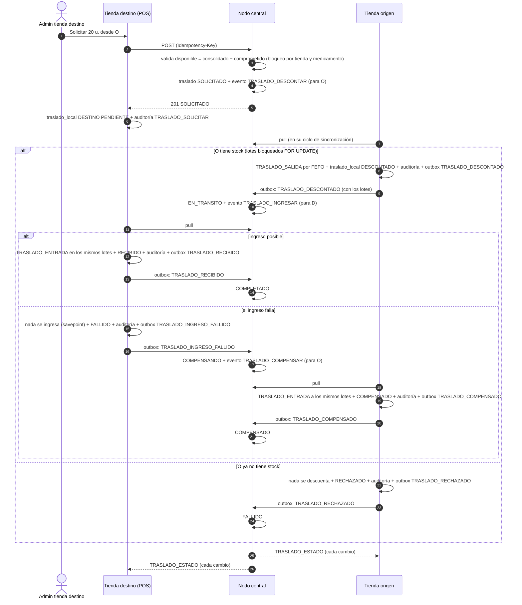

# HU-17 — Coordinar transferencia de medicamentos entre tiendas

Estado: **IMPLEMENTADA** (2026-11-09): saga coordinada por el central (`apps/api/traslados.mjs`), paso de cada tienda (`apps/api/traslados-tienda.mjs`), esquemas en `db/central/14_hu17_traslados.sql` y `db/local/14_hu17_traslados.sql`, pestaña "Traslados" en "Lotes y recepción" y pruebas en verde con **dos tiendas reales** (ver "Pruebas"). Pendiente el veredicto del auditor (GPT-5.6 Luna).

Requerimientos: **RF-26** (traslados entre tiendas con compensación), regla de negocio de traslados (`Traslado.confirmarSalida/Llegada, compensar` del diagrama de clases), **RNF-04** (autonomía: solo las operaciones entre tiendas se degradan sin conexión y se reanudan al volver), **RNF-06** (concurrencia), **RNF-10** (auditoría), **RNF-12**.

## Historia

Como administrador de tienda, quiero solicitar el traslado de un medicamento desde otra tienda de la red cuando no tenga stock suficiente, para poder atender al cliente sin perder la venta.

## Criterios de aceptación

1. Un administrador puede solicitar el traslado de un producto desde una tienda origen con stock disponible hacia su tienda.
2. El descuento en la tienda origen y el ingreso en la tienda destino se coordinan como una única operación confiable.
3. Si el ingreso en la tienda destino falla, el descuento en la tienda origen se revierte automáticamente (compensación).
4. La operación queda registrada de forma auditable en ambas tiendas.
5. La tienda origen no puede quedar con stock negativo como resultado de una transferencia; el sistema valida la disponibilidad antes de iniciar la operación.

## Decisiones (supuestos de la propuesta; pendientes de confirmar con el usuario)

1. **Saga orquestada por el central, no transacción distribuida.** Las tiendas no se ven entre sí y cada una debe poder operar sola; un commit en dos fases bloquearía el stock de una tienda mientras la otra no responde. La "única operación confiable" (criterio 2) es una **saga**: cada paso es una transacción local atómica e idempotente, el central guarda el estado y ordena el paso siguiente o la compensación. El resultado final es siempre uno de tres, igual en las tres bases: completado, revertido o rechazado sin tocar nada.
2. **Viaja por los canales que ya existen.** Las órdenes del central son eventos dirigidos a una tienda (`replica_evento.id_tienda_destino`); las respuestas de la tienda salen por su outbox. No hay conexiones nuevas entre nodos ni puertos abiertos en las tiendas.
3. **Lo pide la tienda destino** (el administrador que necesita el producto, `INVENTARIO_GESTIONAR`), como dice la historia. La tienda origen **no tiene que aprobarlo**: si tiene stock, el sistema lo descuenta solo. Ese paso y la compensación los ejecuta el sistema, así que el movimiento de inventario admite un responsable nulo (igual que la auditoría local de HU-04); quién lo pidió queda en las observaciones, en la auditoría de la tienda origen y en `traslado_local.solicitante`.
4. **Un medicamento por solicitud** (el esquema admite varios; la pantalla y la API piden uno a la vez).
5. **Los mismos lotes.** La tienda destino ingresa las unidades con el mismo número de lote, caducidad y proveedor con que salieron (FEFO en el origen: sale primero lo que vence antes). Si no puede (medicamento inactivo allí, proveedor desconocido, lote vencido o un lote con ese número y otra caducidad), el ingreso **falla y se compensa**.
6. **Sin cancelación manual ni vencimiento.** Una orden que espera a una tienda sin conexión sigue pendiente hasta que la tienda vuelve (RNF-04: se reanuda). Cancelar o expirar un traslado queda pendiente.
7. Sin commits: los cambios quedan en el árbol de trabajo para que el usuario los revise.

## La saga



Estados en el central: `SOLICITADO → EN_TRANSITO → COMPLETADO`, `EN_TRANSITO → COMPENSANDO → COMPENSADO`, `SOLICITADO → FALLIDO`. El disparador `traslado_transicion_trg` rechaza cualquier otro salto. En cada tienda, `traslado_local` guarda su estado local (origen: `DESCONTADO`, `RECHAZADO`, `COMPENSADO`; destino: `PENDIENTE`, `RECIBIDO`, `FALLIDO`, `RECHAZADO`) y el estado de red que le comunica el central (`estado_red`), para que las dos tiendas expliquen el mismo resultado.

## Nodos

- **Central (orquestador):** `traslado` (estado, motivo, clave de idempotencia), `detalle_traslado` (medicamento, cantidad y los lotes que salieron), eventos dirigidos a cada tienda, aplicación idempotente de sus respuestas (`inbox_sync`) y auditoría (`registro_actividad_central`: `TRASLADO_SOLICITAR`, `TRASLADO_EN_TRANSITO`, `TRASLADO_COMPLETADO`, `TRASLADO_COMPENSANDO`, `TRASLADO_COMPENSADO`, `TRASLADO_FALLIDO`).
- **Tienda origen:** descuenta o rechaza, y compensa cuando se lo ordenan. `traslado_local` (rol `ORIGEN`), `movimiento_inventario` (`TRASLADO_SALIDA` y, al compensar, `TRASLADO_ENTRADA`, ligados al traslado), `registro_actividad` (`TRASLADO_SALIDA`, `TRASLADO_RECHAZADO`, `TRASLADO_COMPENSADO`).
- **Tienda destino:** solicita e ingresa. `traslado_local` (rol `DESTINO`), lotes y `TRASLADO_ENTRADA`, `registro_actividad` (`TRASLADO_SOLICITAR` con el administrador, `TRASLADO_ENTRADA`, `TRASLADO_INGRESO_FALLIDO`).

## Online

| Ruta | Permiso | Uso |
| --- | --- | --- |
| `GET /api/local/traslados/origenes?id_medicamento=` | `INVENTARIO_GESTIONAR` | Tiendas de la red con unidades disponibles (consolidado − comprometido) y desde cuándo es el dato. Exige el central |
| `POST /api/local/traslados` | `INVENTARIO_GESTIONAR` + `Idempotency-Key` | Solicitar `{ id_tienda_origen, id_medicamento, cantidad, observaciones? }` hacia la propia tienda. Exige el central |
| `GET /api/local/traslados` | `INVENTARIO_GESTIONAR` | Traslados de la tienda (como origen o destino) desde su base, con su estado de red. Sin conexión también |
| `GET /api/local/traslados/{id}/red` | `INVENTARIO_GESTIONAR` | El traslado según el central, con los lotes |
| `GET /api/central/traslados` | `RED_VISIBILIDAD` | Todos los traslados de la red (consola) |

## Disponibilidad y stock negativo (criterio 5)

Dos barreras:

1. **Antes de iniciar (central):** disponible = stock consolidado de la tienda origen − lo comprometido en traslados que esa tienda aún no descontó. Un bloqueo consultivo por tienda y medicamento pone en fila las solicitudes simultáneas. Si no alcanza: `409 STOCK_INSUFICIENTE_ORIGEN` con el disponible.
2. **Al descontar (tienda origen, definitiva):** el consolidado puede ir atrasado. La tienda bloquea sus lotes vendibles (`FOR UPDATE`, en orden de `id_lote` como la venta) y, si no alcanzan, **rechaza sin tocar nada**. Cada descuento pasa por `registrarMovimiento`, que nunca deja un lote en negativo.

## Fallos, reintentos y duplicados

- **Cada paso es atómico.** El descuento (o ingreso, o compensación), el `traslado_local`, la auditoría y la respuesta al central se confirman juntos en la transacción del pull de la tienda.
- **Fallo de negocio frente a fallo técnico.** Un fallo de negocio (no hay stock, lote inconsistente…) se revierte con un savepoint y se responde como rechazo o fallo de ingreso. Uno técnico (conexión) revierte el pull entero, que se reintenta en el próximo ciclo sin perder la orden.
- **Órdenes repetidas:** cada tienda mira su `traslado_local` antes de actuar. Una orden entregada dos veces (un pull reintentado) no descuenta, ingresa ni repone dos veces; la prueba lo fuerza.
- **Respuestas repetidas:** el central aplica cada una una sola vez (`inbox_sync`) y solo si el traslado está en el estado que corresponde. Una respuesta tardía o de otra tienda no lo mueve. Las respuestas llevan una clave estable por traslado y paso (`ON CONFLICT DO NOTHING` en el outbox).
- **Solicitud repetida:** misma `Idempotency-Key`, mismo traslado (índice único `ux_traslado_idempotency`).
- **Compensación que no se puede aplicar** (no debería ocurrir: solo suma unidades a lotes propios): queda en `sync_conflicto` de la tienda (regla 5: nunca en silencio) y la réplica sigue.

## Offline y latencia

- **Solicitar exige el central** (503 `SIN_CONEXION`): es quien conoce el stock de la red y coordina. La lista de traslados de la tienda se consulta sin conexión.
- **Una tienda sin conexión no frena a la otra ni pierde la orden.** Si la tienda origen está offline, el traslado queda `SOLICITADO` y nada se descuenta; al reconectar recibe la orden y la saga sigue. Lo mismo con la destino en `EN_TRANSITO`. La prueba lo comprueba con la tienda origen offline.
- **Latencia alta no equivale a desconexión:** la solicitud usa `enCentral`, que distingue el estado offline de un fallo a mitad de la operación (503, no 500). Los pasos de las tiendas corren en su ciclo de sincronización (cada `SYNC_INTERVALO_MS`, 10 s por defecto), así que un traslado completo tarda unos pocos ciclos.

## Implementación

| Pieza | Archivo |
| --- | --- |
| Orquestación (solicitud, respuestas de las tiendas, consultas) | `apps/api/traslados.mjs` |
| Paso de cada tienda (descontar, ingresar, compensar, estado) | `apps/api/traslados-tienda.mjs`, registrado en `apps/api/sync/handlers/index.mjs` |
| Respuestas en el central | `apps/api/sync/central.mjs` (`TRASLADO_*`, import perezoso) |
| Rutas | `apps/api/routes/traslados.mjs`, registradas en `apps/api/app.mjs` |
| Esquema | `db/central/14_hu17_traslados.sql`, `db/local/14_hu17_traslados.sql` |
| Interfaz | `apps/web/src/Traslados.jsx` (pestaña "Traslados" en `Lotes.jsx`) |
| Pruebas | `scripts/probar-hu17.mjs` (`npm run test:hu17`) y la segunda tienda `scripts/hu17-nodo.mjs` |

Cambios en código existente:

- `registrarMovimiento` (HU-02) acepta el rol del traslado y, solo para un paso de traslado, un responsable nulo.
- El historial de un lote muestra "Sistema (traslado)" en esos movimientos.
- `movimiento_inventario.id_empleado` admite nulo.
- `migrate.mjs` busca la tabla base sin fijar el esquema `public`, respetando el `search_path` de la conexión. Para una base normal es lo mismo; la prueba lo usa para su segunda tienda.
- Las comprobaciones de restricciones de mis scripts de HU-11 y HU-13 ahora filtran también por tabla.

## Validación de esquema

| Dato | Definición | Uso |
| --- | --- | --- |
| Traslado | `traslado` (base) + `motivo`, `actualizado_en`, `idempotency_key`; `estado IN (SOLICITADO, EN_TRANSITO, COMPLETADO, COMPENSANDO, COMPENSADO, FALLIDO)` | Estado de la saga |
| Detalle | `detalle_traslado` (base) + `lotes jsonb` (número, caducidad, proveedor, cantidad) | Lo que el destino ingresa |
| Transiciones | `traslado_transicion_trg` | Sin saltos ni retrocesos |
| Copia en la tienda | `traslado_local` (base, PK `(id_traslado, rol_tienda)`) + `estado_red`, `motivo`, `solicitante`, `actualizado_en`; estados locales ampliados con `RECHAZADO` y `FALLIDO` | Lo que cada tienda sabe |
| Movimientos | `movimiento_inventario.id_traslado`, `rol_tienda_traslado` (base, FK a `traslado_local`), `id_empleado` nulo para el sistema | Trazabilidad y compensación exacta |

## Criterios Gherkin

```gherkin
# language: es
Característica: HU-17 Coordinar transferencia de medicamentos entre tiendas

  Escenario: Solicitar desde una tienda con stock
    Dado que la tienda "Sur" tiene 50 unidades de "Prueba Traslado" según el central
    Cuando el administrador de "Centro" consulta de dónde pedirlo
    Entonces ve "Sur" con 50 unidades disponibles
    Cuando solicita 20 unidades
    Entonces el traslado queda SOLICITADO y "Centro" lo ve PENDIENTE
    Y "Sur" queda con 30 disponibles para otros traslados

  Escenario: Descuento e ingreso como una sola operación
    Dado un traslado de 20 unidades SOLICITADO
    Cuando "Sur" sincroniza
    Entonces descuenta 20 por FEFO y el central pasa a EN_TRANSITO con los lotes
    Cuando "Centro" sincroniza
    Entonces ingresa 20 en el mismo lote, caducidad y proveedor
    Y el central lo completa y las dos tiendas ven COMPLETADO

  Escenario: Si el ingreso falla, el origen se compensa solo
    Dado que "Centro" tiene un lote con el mismo número y otra caducidad
    Cuando llega el traslado de 5 unidades de ese lote
    Entonces "Centro" no ingresa nada y lo marca FALLIDO con el motivo
    Y el central pasa a COMPENSANDO y ordena la compensación
    Y "Sur" repone las 5 unidades al mismo lote sin que nadie intervenga
    Y el traslado termina COMPENSADO en las tres bases

  Escenario: Auditoría en ambas tiendas
    Dado un traslado completado
    Entonces "Centro" registra TRASLADO_SOLICITAR (con el administrador) y TRASLADO_ENTRADA
    Y "Sur" registra TRASLADO_SALIDA con quién lo solicitó
    Y el central registra cada cambio de estado

  Escenario: Nunca stock negativo en el origen
    Cuando se solicitan más unidades de las que el central ve disponibles
    Entonces recibe 409 STOCK_INSUFICIENTE_ORIGEN
    Dado que "Sur" vendió su stock y el central aún no lo sabe
    Cuando llega la orden de descontar 25 unidades y solo hay 10
    Entonces "Sur" la rechaza sin descontar nada y el traslado queda FALLIDO
    Y ningún lote queda en negativo

  Escenario: Solicitudes simultáneas
    Dado 10 unidades disponibles en "Sur"
    Cuando dos administradores piden 6 unidades a la vez
    Entonces una solicitud entra y la otra recibe 409

  Escenario: Entregas repetidas
    Cuando la orden de descontar o de compensar llega dos veces
    Entonces el stock cambia una sola vez
    Y una respuesta repetida al central no altera el traslado
    Y la misma Idempotency-Key devuelve el mismo traslado

  Escenario: Tiendas sin conexión
    Dado que "Centro" no alcanza al central
    Cuando el administrador solicita un traslado
    Entonces recibe 503 SIN_CONEXION
    Pero consulta los traslados de su tienda
    Dado que "Sur" no alcanza al central
    Cuando se solicita un traslado desde "Sur"
    Entonces queda SOLICITADO y nada se descuenta
    Y al reconectar "Sur" la saga sigue y se completa

  Escenario: Solo el administrador solicita
    Dado que "cajero1" tiene sesión en el POS
    Cuando intenta solicitar o ver traslados
    Entonces recibe 403
```

## Pruebas

`npm run test:hu17` (`scripts/probar-hu17.mjs`). La prueba usa **dos tiendas reales**:

- **Destino:** la tienda del `.env`.
- **Origen:** una tienda creada para la corrida por la API de HU-15. Corre el mismo código del API en un proceso hijo (`scripts/hu17-nodo.mjs`), con su base en un esquema propio de la base local (`hu17_<corrida>`).

La saga recorre los mismos canales que en producción: eventos dirigidos del central y outbox de cada tienda. Escribe en las bases del `.env`; con Neon exige `PERMITIR_NEON=1`. Correr con el API detenido y **una sola corrida a la vez**. Al terminar, la tienda de la corrida queda desactivada (tiene traslados y no se puede borrar), su esquema se borra y el medicamento queda inactivo.

Limitación de la segunda tienda: algunos scripts antiguos (de otras historias) comprueban sus restricciones solo por nombre, y en el esquema de prueba encuentran las de `public`, así que esas restricciones opcionales no se crean ahí. No afecta lo que esta historia usa (lotes, movimientos, traslados, auditoría y outbox vienen del script base).

Resultado (2026-11-09, rama de Neon `Sprint3_Simon_HU`): `test:hu17` 65/65, dos corridas. Regresión, todas en "TODO OK": `test:hu02` 38/38, `test:hu01` 39/39, `test:hu04` 64/64, `test:hu14` 57/57, `test:hu13` 94/94, `test:hu08` 85/85, `test:hu10` 65/65, `test:hu11` 80/80, `test:hu09` 49/49, `test:hu05` 64/64, `test:hu12` 71/71, `probar-hu15` 19/19, `test:hu06` 38/38, `test:hu07` 63/63, `test:hu03` 44/44, `test:hu16` 56/56 y `test:sync` (con el API levantado). `db:verificar --estricto` no encontró diferencias en central ni en local. La interfaz compila (`vite build`).

Hallazgo corregido: en la primera corrida, la actualización del estado de red en la tienda (`TRASLADO_ESTADO`) fallaba por un tipo de parámetro ambiguo (`text` frente a `varchar`). Como corre dentro del pull, habría frenado toda la réplica de la tienda hasta corregirlo. Ahora los parámetros llevan su tipo explícito.

Recorrido en el navegador como `admin.tienda`: la pestaña "Traslados" de "Lotes y recepción" lista los traslados de la tienda con su estado de red (completados, revertidos, rechazados), quién los pidió y el motivo. Al buscar un medicamento, el formulario muestra las tiendas de la red que lo tienen, con las unidades disponibles y la hora del dato, y avisa antes de enviar si se pide más de lo disponible. No se envió una solicitud desde la interfaz: en este entorno solo corre el nodo de una tienda, así que un traslado pedido a otra tienda de la demo quedaría `SOLICITADO` hasta que ese nodo se conecte (comportamiento correcto, pero dejaría un traslado pendiente en la rama). La saga completa la cubre la prueba con dos nodos reales. No se recorrió en un celular.

## Pendiente para otras historias

- **Cancelar o vencer un traslado** que espera a una tienda sin conexión mucho tiempo (con compensación si ya se descontó).
- **Aprobación de la tienda origen** antes del descuento, y la logística física (despacho, guía, transportador, recepción con diferencias como en HU-14).
- **Varios medicamentos por solicitud** en la pantalla (el esquema y la saga ya los admiten).
- **Pedir el traslado desde la venta** cuando falta stock (hoy desde "Lotes y recepción").
- **Notificación** a la tienda origen y al solicitante cuando el traslado termina.

## Ciclo

| Paso | Resultado |
| --- | --- |
| Propuesta (Grok 4.7) | Esta propuesta: decisiones, nodos, offline, duplicados y conflictos. **Pendiente de revisión por el usuario** |
| Auditor GPT-5.6 Luna | pendiente (sin `APROBADO` la historia no está lista para el backlog según `AGENTS.md`) |
| Subagentes técnicos | `analista-contexto`, `redactor-criterios` y `disenador-flujos`: pendientes; el Gherkin y el diagrama de arriba son provisionales |
| Implementación y pruebas | Ver "Pruebas" (2026-11-09) |
